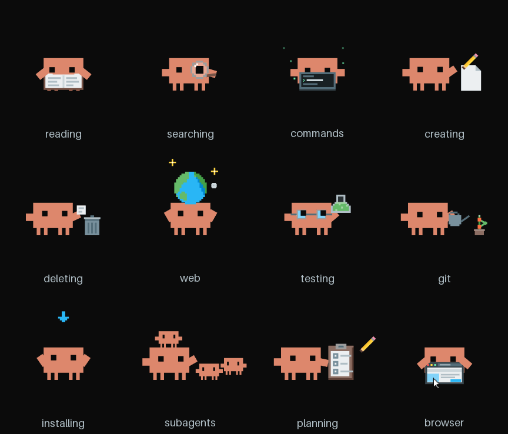

# Claude Presence GIFs

Animated pixel-art Clawd GIFs for a personal Discord Rich Presence that shows what Claude Code is doing.

| File | Shown while Claude is… |
|---|---|
| `clawd-reading.gif` | reading files |
| `clawd-searching.gif` | searching code |
| `clawd-commands.gif` | running commands |
| `clawd-creating.gif` | creating files |
| `clawd-deleting.gif` | deleting files |
| `clawd-web.gif` | searching or reading the web |
| `clawd-testing.gif` | running tests |
| `clawd-git.gif` | using git |
| `clawd-installing.gif` | installing packages |
| `clawd-subagents.gif` | running subagents |
| `clawd-planning.gif` | planning |
| `clawd-browser.gif` | using the browser |

Each is 1080×1080 at 50 fps and loops seamlessly. They were drawn in code to match the style of the Clawd animations used by [claude-rpc](https://github.com/rar-file/claude-rpc).

Clawd is the Claude Code mascot. These are fan-made and not affiliated with or endorsed by Anthropic.
